<br />
<div align="left">
  

  
  <br />
  <h3>&nbsp;&nbsp;Pijin</h3>
  <p>&nbsp;&nbsp;<b><i>Bringing digital money within reach, even offline.</i></b></p>
</div>
<br clear="left"/>
 
<p align="center">
  
  
</p>


## ⭐️ Hackathon Track 

**Local Finance & Real World Access** - Build applications that connect real-world assets to blockchain infrastructure. 

---

## 🧩 Problem

Many people in rural areas, remote communities, and provincial towns have limited, unreliable, or zero access to 4G/WiFi. Because of this, they are often excluded from using e-wallets and digital transactions that require a constant broadband internet connection. This affects small merchants, everyday users wanting to send money to family, transportation operators, and anyone who wants to participate in digital payments but cannot rely on online systems.

Our problem is: **How can people continue to access secure, real-time digital peer-to-peer (P2P) payments in zero-data areas without requiring users to buy expensive hardware or assume the risk of delayed settlement?**


## 💡 Solution

Pijin is a Web2.5 data-free unified payment system that bridges cutting-edge blockchain cryptography with ubiquitous cellular infrastructure (GSM/SMS). The system enables seamless peer-to-peer (P2P) transfers regardless of geographic distance or internet availability.

Users fund their wallets online via regulated Stellar Anchors (SEP-24) and secure those funds in an on-chain escrow vault.  To ensure a frictionless user experience, the system relies on an offline-first architecture using a high-performance local database (Drizzle ORM) on the phone. This guarantees immediate UI updates locally while the heavy lifting of blockchain communication is offloaded to the cellular network.

When transitioning to a zero-data environment, Pijin lets users choose an SMS-based transport path based on whether they can send a text themselves. To initiate a transfer, the sender captures the receiver's ShortID—either by scanning a static QR code or entering it manually—and the app securely signs a compact payment voucher offline. If the sender has cellular load, Pijin opens the phone's native SMS composer with the signed payload and gateway number prefilled. If the sender has no load, the app generates a dynamic Payload QR code that a bystander can scan and forward by SMS without being able to alter the signed payment details. The inbound SMS is authenticated by our Zero-API Gateway and queued for a cloud relayer, which submits the payment to the Soroban smart contract. The contract verifies the sender's registered offline signature, rejects previously settled nonces, resolves the receiver's ShortID, and atomically updates the on-chain vault balances once the transaction is confirmed.


## 🌟 Vision

Pijin aims to make digital transactions more inclusive by providing universal Web3 liquidity powered by cellular networks. We want e-transactions to be available not only to people in cities with stable internet, but also to people in rural and underserved areas relying on basic cell towers. A future where digital payments are within reach for everyone, regardless of internet reliability.


## 🎯 Purpose

The fundamental purpose of Pijin is to decouple decentralized finance from broadband internet dependency. We aim to empower unbanked, offline, and remote communities to participate in real-time digital economies without being forced to upgrade their hardware or rely on continuous cellular data. By transforming legacy telecommunication bands (like standard GSM/SMS and low-power RF) into trustless cryptographic transport layers, Pijin ensures that true financial inclusion—where users retain absolute sovereignty over their funds—can reach the most infrastructure-limited regions on the globe.


## 👥 Target Users

Pijin is designed as a universal digital cash app for communities and users who experience unreliable mobile data but have basic GSM cellular coverage.
<br>

Our target users include:
- Everyday users sending P2P remittances to family and friends.
- Small retail store owners and wet market vendors.
- Tricycle drivers and transport operators.
- Rural households and island communities.
- LGUs and NGOs that need data-free aid distribution systems.
<br>

The app uses familiar, **non-technical** labels:
- Online Balance
- Offline Cash Vault
- Send Money
- Receive Money

## ✨ Pijin Features

- **Non-Custodial Offline Cryptography:** Pijin generates two keys on the device: a wallet key for the Stellar account and a device key registered on-chain for offline signing. Transactions are signed and sealed completely offline. Central servers act only as "dumb pipes" and cannot intercept or alter user funds.
- **Dynamic Zero-Data Routing:** Transport switches to compressed SMS as soon as the device loses internet connectivity.
- **Bystander "Dumb-Pipe" Relay (Payload QR):** A sender with zero cellular load can show a signed "Payload QR." Any bystander with a text promo can scan it and send the transaction for them without being able to change it.
- **Deterministic Compression:** Amounts are Base62-encoded and nonces/signatures are sent as unpadded Base64. A full Soroban payment intent fits in a single 6-part SMS: `tokenId:senderShortId:receiverShortId:amount:nonce:signature`.
- **On-Chain State Resolution:** The Soroban contract resolves 6-character, case-sensitive ShortIDs to Stellar addresses through an on-chain registry managed by a narrowly-scoped registrar key. This solves the "cold start" problem for offline phones.
- **Seamless Fiat On/Off-Ramp (SEP-24):** Interactive deposit and withdrawal webviews convert GCash to PHPC/USDC and back. Per-transaction and daily limits and kill switches are enforced server-side.
- **Dual Wallet and Offline Vault Architecture:** Online wallet funds are kept separate from a per-token offline vault inside the contract. Users move funds between them, and only vault funds can be spent offline.
- **Automatic Offline Payment Queue and Reconciliation:** Offline payments are stored in SQLite, queued while disconnected, and reconciled against backend settlements by nonce. This prevents duplicate settlement.
- **Durable Message Queue Settlement Pipeline:** Authenticated SMS webhooks validate signed payloads and buffer them through Upstash QStash. Deduplication IDs make repeated deliveries idempotent, and retries isolate clients from temporary database or Stellar RPC failures.
- **Distributed API Rate Limiting:** Upstash Redis sliding-window limits protect SMS ingress, OTP delivery, registration, lookups, balances and history. Limits are scoped by phone number, IP or public key.
- **Local-First Transaction History:** History is stored in SQLite and synced with backend records. Wallet, Offline Funds and combined views are available.
- **SEP-10 Authentication:** The app fetches a challenge from the anchor, signs it with the wallet key, and exchanges it for a short-lived JWT used by ramps, ShortID registration and device-key enrollment.
- **SMS Transaction Receipts:** After settlement, receipts are queued and sent to both parties at a throttled rate, so receipts never starve OTP delivery.
- **Browser Simulator:** A two-phone simulator (`/demo-split`) leases pre-provisioned Testnet accounts and runs the real signing, webhook, queue and on-chain settlement flow.

## 🚀 Getting Started

> [!TIP]
> The full **[Setup & Integration Guide](https://pijin.live/docs)** (also in [`docs/SETUP.md`](docs/SETUP.md)) covers contract deployment, asset minting, the SMS gateway, EAS builds, Vercel deployment and API integration step by step.

### Repository structure

| Path | Description |
|---|---|
| [`apps/backend`](apps/backend) | Next.js 16 API, SEP-1/10/24 anchor, SMS webhook, QStash workers, landing page, simulator and docs |
| [`apps/mobile`](apps/mobile) | Expo 52 / React Native 0.76 Android app |
| [`contracts`](contracts) | Pijin Soroban smart contract (Rust) |
| [`packages/pijin_core`](packages/pijin_core) | Generated TypeScript bindings for the contract |
| [`docs`](docs) | Setup guide and security notes |

### Prerequisites

- Node.js 20+ and npm 10+
- Rust (stable) with the `wasm32v1-none` target, and the [Stellar CLI](https://developers.stellar.org/docs/tools/cli)
- PostgreSQL (Neon recommended), Upstash QStash + Redis, and a Textbee account with an Android SIM gateway
- Android Studio + JDK 17 for the mobile app (or an Expo/EAS account for cloud builds)

### Installation

```bash
git clone https://github.com/0xreru/Pijin.git
cd Pijin

# Install all workspaces and build the contract bindings
npm install
npm run build:sdk

# Configure environment variables
cp apps/backend/.env.example apps/backend/.env
cp apps/mobile/.env.example apps/mobile/.env

# Prepare the database
cd apps/backend
npx prisma generate
npx prisma migrate deploy

# Start the API, landing page and docs → http://localhost:3000
npm run dev
```

### Run the mobile app

```bash
cd apps/mobile
npm run android        # build and install the development client
npm start              # start Metro once the dev client is installed
```

### Build and test the contract

```bash
cd contracts
make test              # cargo test
make build             # → target/wasm32v1-none/release/pijin_contract.wasm
```

### Run the tests

```bash
npm run typecheck                  # backend + pijin_core
cd apps/backend && npm test        # security, settlement and demo suites
cd contracts && cargo test         # contract unit tests
```

## 🏛️ Pijin Architecture

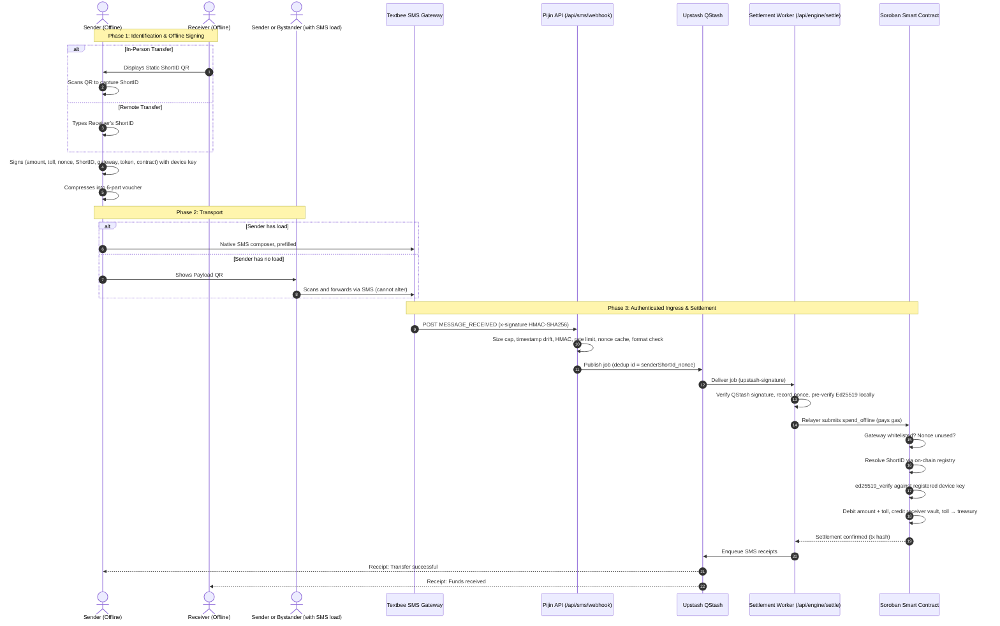

## 🌍 Stellar Ecosystem Proposal(SEP) Protocol Integration

| SEP | Where | What Pijin does |
|---|---|---|
| **SEP-1** (Stellar Info File) | `GET /.well-known/stellar.toml` | Publishes `WEB_AUTH_ENDPOINT`, `SIGNING_KEY`, `TRANSFER_SERVER_SEP0024` and the PHPC/USDC currencies, built from environment variables at request time. |
| **SEP-10** (Web Authentication) | `GET` / `POST /api/auth` | Issues a signed challenge with a random 48-byte nonce, verifies the client's signing weight against Horizon, and returns an HS256 JWT. |
| **SEP-24** (Hosted Deposit & Withdrawal) | `/api/sep24/*`, `/api/anchor/*` | `info`, interactive deposit/withdraw, and transaction polling. Webviews use a separate 15-minute interactive token. Withdrawals are confirmed by checking the on-chain payment (amount, asset, memo, treasury) on Horizon. |

## 📃 Smart Contract Functions - Pijin Smart Contract

- **Initialization & Upgrades**
  - `__constructor(env, admin, treasury)`: Protocol 22 initialization that sets the privileged Admin and Treasury addresses. The Admin is also the default Registrar.
  - `upgrade(env, new_wasm_hash)`: Lets the Admin upgrade the contract to a new WASM, keeping all storage.

- **User Vault Management**
  - `deposit(env, sender, token, pubkey, amount)`: Transfers Stellar Asset Contract or Soroban tokens from the user's wallet into a per-token vault and registers the user's Ed25519 offline signing key.
  - `withdraw(env, sender, token, amount)`: Moves tokens from the sender's vault back to their Stellar wallet. Partial and full withdrawals are supported; a full withdrawal removes the storage entry (no more storage rent).
  - `get_vault(env, user, token)`: Read-only vault balance for a user and token.

- **Offline Payment Engine (Data-Free Transport)**
  - `spend_offline(env, gateway, sender, token, receiver_short_id, amount, protocol_toll, nonce, signature)`: The core offline settlement engine, callable only by a whitelisted gateway. It verifies the 7-field voucher signed by the sender's `offline_key`, rejects replayed nonces, resolves the receiver's `short_id`, debits amount + toll from the sender's vault, credits the receiver's vault, transfers the toll to the treasury, and emits a `spend` event.
  - `set_offline_key(env, sender, pubkey)`: Lets a vault owner rotate their registered offline signing device without making a deposit.
  - `get_offline_key(env, sender)`: Read-only check that a device is still the active registered signer.

- **Recipient Identity Registry (Short-ID Mapping)**
  - `set_registrar(env, admin, registrar)`: Admin control to assign a narrowly-scoped backend signer for short-ID mappings.
  - `get_registrar(env)`: Read-only lookup of the current registrar. The backend checks it before registering IDs.
  - `register_recipient(env, registrar, short_id, receiver)`: Registrar-only. Maps a 6-byte Base62 `short_id` to a Stellar address. Idempotent for identical mappings.
  - `update_recipient(env, registrar, short_id, receiver)`: Registrar-only. Moves an existing `short_id` mapping to a new address.
  - `get_recipient(env, short_id)`: Read-only lookup from a short ID to its Stellar address.

- **Gateway Access Control**
  - `register_gateway(env, admin, gateway)`: Whitelists a relayer address allowed to submit `spend_offline` transactions.
  - `remove_gateway(env, admin, gateway)`: Revokes a gateway's submission permission.

- **Error codes**: `AlreadyInitialized (1)`, `Unauthorized (2)`, `InvalidAmount (3)`, `ExpiredVoucher (4)`, `NonceReplayed (5)`, `InsufficientBalance (6)`, `RecipientNotFound (7)`, `MathOverflow (8)`, `NotWhitelistedGateway (9)`, `ShortIdAlreadyRegistered (10)`, `RegistrarNotConfigured (11)`, `InvalidShortId (12)`.

## 🔐 Applied Security

| Layer | Protection |
|---|---|
| **Keys** | Wallet and device keys are generated and kept on the phone. The backend only assembles unsigned Soroban transactions for the phone to sign. |
| **Voucher integrity** | The Ed25519 signature covers amount, toll, nonce, receiver ShortID, gateway, token and contract address, so a voucher cannot be altered or replayed on another deployment. |
| **Replay protection** | Four layers: Redis nonce cache at the webhook, QStash deduplication ID, a unique nonce in the database, and on-chain nonce storage (`NonceReplayed`). |
| **SMS ingress** | Streaming 2 KB body cap, optional ±300 s timestamp drift, constant-time HMAC-SHA256 (`TEXTBEE_WEBHOOK_SECRET`), per-phone rate limit and strict 6-part format validation. |
| **Queue workers** | `/api/engine/settle` and `/api/sms/dispatch` accept only QStash-signed requests (fail-closed in production). Infrastructure errors are retried; contract rejections are not. |
| **Gas-drain firewall** | The worker verifies the voucher signature locally before spending relayer gas on a Soroban call. |
| **On-chain roles** | Separate admin, registrar and whitelisted gateway roles. Overflow-checked arithmetic, ShortID validation and persistent TTL extension. |
| **Authentication** | SEP-10 JWTs for protected APIs; wallet-signed canonical messages for vault operations; separate 15-minute interactive tokens for SEP-24 webviews. |
| **Accounts** | OTP via `crypto.randomInt` with a 5-minute TTL, attempt limits and a global hourly cap; scrypt-hashed PINs with lockout after 5 failures; optional mandatory OTP token at registration. |
| **Ramps** | Kill switches, per-transaction and daily limits, ownership-checked state transitions and a ramp audit log. Withdrawals are verified on Horizon before payout. |
| **Logging** | Phone numbers are masked, and Stellar secrets, signing keys and bearer tokens are redacted from logs. |

See [`docs/deliverable-2-security-summary.md`](docs/deliverable-2-security-summary.md) for the webhook and queue hardening details.

## 🛠️ Tech Stack

- **Mobile App**
  - **Framework:** React Native 0.76 with Expo 52 (development build, EAS)
  - **Local Database:** SQLite (`expo-sqlite`) with Drizzle ORM
  - **Stellar:** `@stellar/stellar-sdk` for offline Ed25519 signing, XDR and Soroban calls
  - **Other:** React Navigation, NetInfo connectivity detection, Expo Camera QR scanning, WalletConnect

- **Backend (API)**
  - **Framework:** Next.js 16 (App Router route handlers), React 19, TypeScript
  - **Database & ORM:** PostgreSQL (Neon serverless) with Prisma 7
  - **Queues & Caching:** Upstash QStash (settlement and SMS jobs) and Upstash Redis (rate limits, OTP, replay cache)
  - **Docs:** OpenAPI 3 generated with `next-swagger-doc` and rendered with Swagger UI
  - **Testing:** `node:test` via `tsx`, property-based tests with `fast-check`

- **Smart Contract**
  - **Blockchain:** Stellar / Soroban (Protocol 22)
  - **Language:** Rust with `soroban-sdk` 22, compiled to `wasm32v1-none`
  - **Bindings:** TypeScript client generated by the Stellar CLI (`packages/pijin_core`)

- **Integrations**
  - **SMS Gateway:** Textbee (inbound webhooks and outbound SMS through an Android SIM)
  - **Anchor:** SEP-1, SEP-10 and SEP-24 served by the Pijin backend
  - **Hosting:** Vercel (backend), EAS (Android builds)
  - **CI:** GitHub Actions (backend typecheck/tests/build, contract test/wasm build, mobile typecheck/export)

## 📚 API Documentation

The Pijin backend connects the mobile app, the Soroban contract and the Stellar network.

- 👉 **[Interactive API Reference](https://pijin.live/api-docs)**: OpenAPI 3 with request/response schemas and "Try it out"
- 👉 **[Setup & Integration Guide](https://pijin.live/docs)**: auth flows, vault operations and the offline voucher format
- Raw spec: [`/api/swagger`](https://pijin.live/api/swagger)

### Authentication schemes

| Scheme | Header | Used by |
|---|---|---|
| SEP-10 JWT | `Authorization: Bearer <jwt>` | SEP-24 ramps, ShortID registry, device-key enrollment |
| Wallet signature | `Authorization: Bearer <base64 Ed25519 sig>` | `/api/engine/deposit`, `/withdraw`, `/transfer` |
| SEP-24 interactive token | `Authorization: Bearer <jwt>` | `/api/anchor/*` webview steps |
| Textbee HMAC | `x-signature` | `/api/sms/webhook` |
| QStash signature | `upstash-signature` | `/api/engine/settle`, `/api/sms/dispatch` |

### Core Services

**System & Discovery**
- `GET /api/health` — Liveness probe; `?deep=1` adds SMS gateway status.
- `GET /.well-known/stellar.toml` — SEP-1 anchor identity file.
- `GET /api/swagger` — OpenAPI specification.

**Authentication & Accounts**
- `GET /api/auth` / `POST /api/auth` — SEP-10 challenge and JWT exchange.
- `POST /api/otp/send` / `POST /api/otp/verify` — 6-digit SMS OTP. Verify returns a 30-minute phone verification token.
- `POST /api/register` — Creates an account and its 6-character ShortID.
- `POST /api/auth/pin/verify` — Server-side PIN check with lockout.
- `GET /api/users/check` — Is this phone registered?
- `GET /api/users/lookup` — Resolve a ShortID or phone number to account details.

**Offline Engine**
- `POST /api/engine/deposit` / `POST /api/engine/withdraw` — Assemble vault deposit/withdraw transactions for the wallet to sign.
- `POST /api/engine/transfer` — Assemble an online token transfer.
- `POST /api/engine/recipient-registry` — Register the caller's ShortID on-chain and return the offline signing config.
- `POST` / `PATCH /api/engine/offline-key` — Enroll, rotate and confirm the offline device key.
- `POST /api/engine/settle` — QStash-only settlement worker that submits `spend_offline`.
- `POST /api/settlements` — Direct (synchronous) settlement of a signed voucher.

**SMS Gateway**
- `POST /api/sms/webhook` — HMAC-authenticated Textbee ingress that enqueues settlement jobs.
- `POST /api/sms/dispatch` — QStash worker that delivers receipt SMS.

**Wallet & History**
- `GET /api/wallet/balance` — Online (Horizon) balance for PHPC/USDC.
- `GET /api/vault-balance` — Offline vault balance from the contract.
- `GET /api/wallet/history` — Merged offline, online and anchor history.
- `GET /api/transactions` — Raw settled offline transactions.
- `POST /api/wallet/transfers/confirm` — Confirm an online transfer by hash.

**Fiat On/Off Ramps (SEP-24 Anchor)**
- `GET /api/sep24/info` — Supported assets.
- `POST /api/sep24/transactions/deposit/interactive` / `.../withdraw/interactive` — Start a deposit or withdrawal and get the webview URL.
- `GET /api/sep24/transaction` — Poll the status of a transaction.
- `POST /api/anchor/simulate-payment` — Webview step that pays out a deposit.
- `POST /api/anchor/submit-withdraw` / `POST /api/anchor/confirm-withdraw` — Submit withdrawal details, then verify the user's on-chain payment.

**Demo & Testnet**
- `POST /api/friendbot` — Fund a new Testnet account (rate limited).
- `POST` / `DELETE /api/demo/session`, `GET /api/demo/settlement` — Browser simulator sessions and settlement polling.


## Pijin Treasury Portal

The **Pijin Treasury Portal** serves as the central command center for network administrators. Built parallel to the offline mobile app and relay infrastructure, it provides real-time visibility, smart contract administration, gateway node orchestration, and liquidity management across the Stellar Network.

- [Pijin Treasury Portal Repository](https://github.com/Kaido147/Pijin_Treasury_Portal)
- [Pijin Treasury Portal](https://pijin-treasury-portal.vercel.app) 

## 📸 Screenshots

Every screen and sub-screen of the live Pijin mobile app, captured from the deployed Android build. All screenshot are in [`screenshots/`](screenshots/).

<details open>
<summary><strong>Onboarding and secure access</strong> (mobile)</summary>

<br />

<table>
<tr>
<td align="center">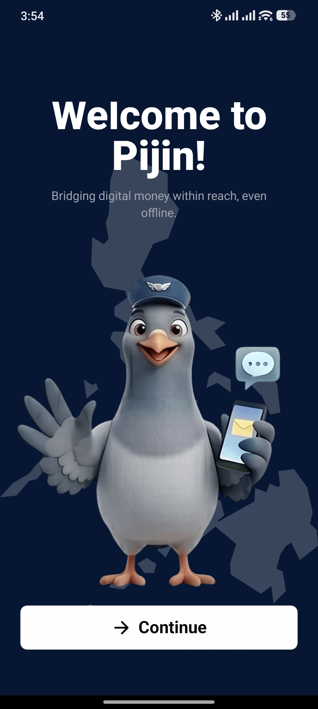<br /><sub>Welcome to Pijin</sub></td>
<td align="center">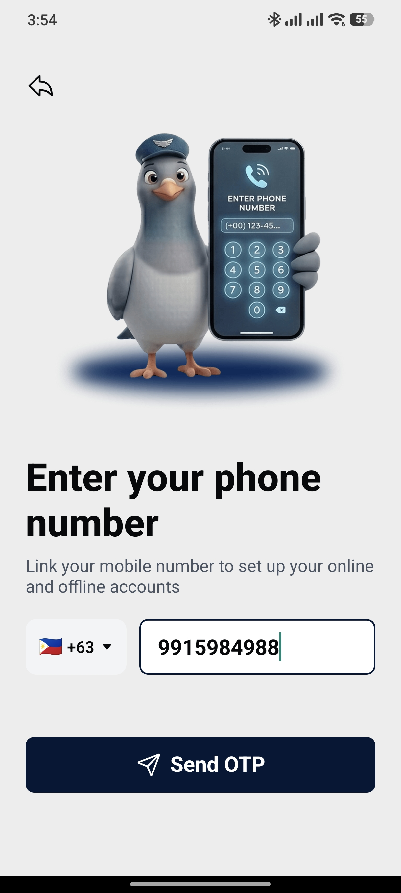<br /><sub>Enter phone number</sub></td>
<td align="center">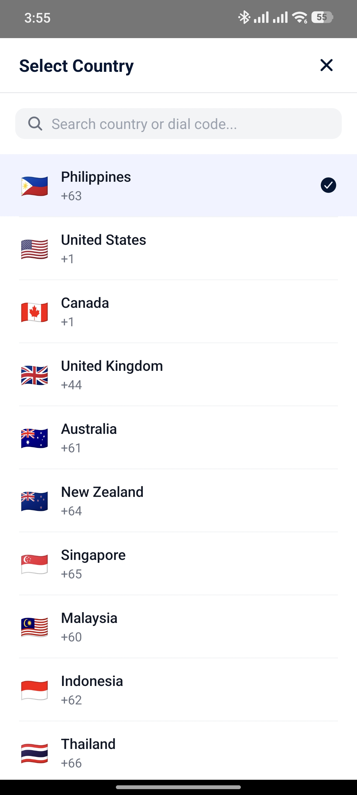<br /><sub>Select country</sub></td>
<td align="center">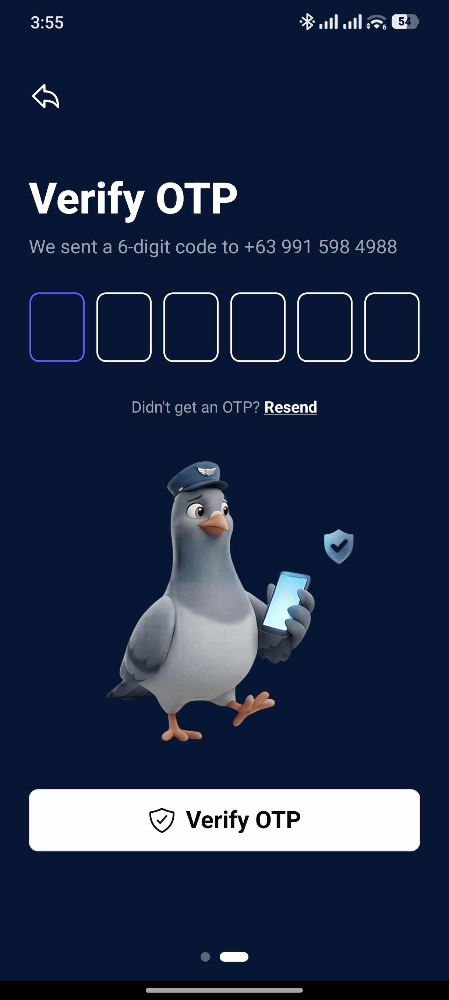<br /><sub>Verify OTP</sub></td>
</tr>
<tr>
<td align="center">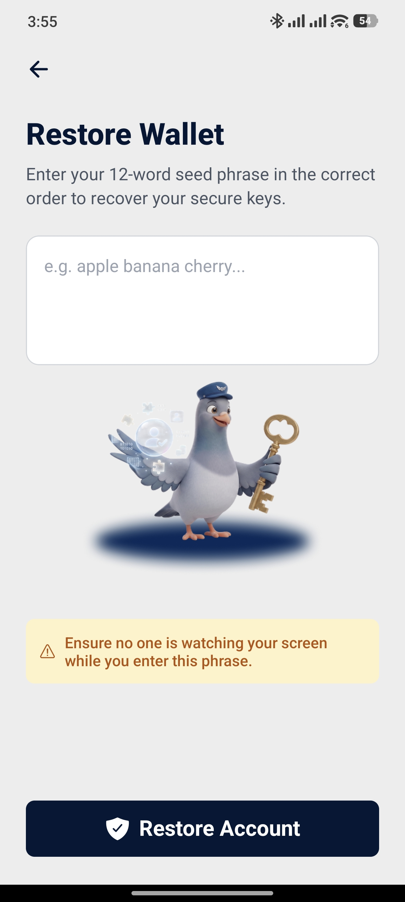<br /><sub>Restore wallet</sub></td>
<td align="center">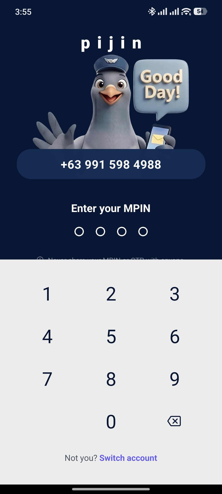<br /><sub>MPIN sign-in</sub></td>
<td></td>
<td></td>
</tr>
</table>

</details>

<details open>
<summary><strong>Wallet, activity, and QR tools</strong> (mobile)</summary>

<br />

<table>
<tr>
<td align="center">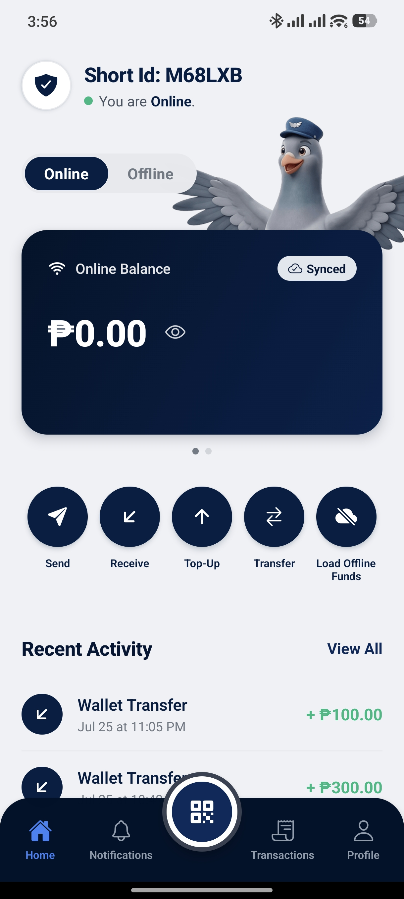<br /><sub>Online wallet</sub></td>
<td align="center">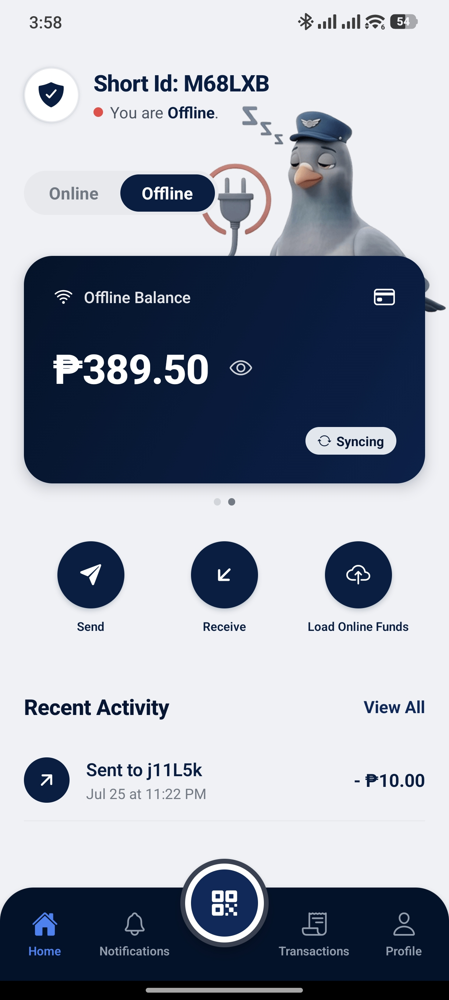<br /><sub>Offline vault</sub></td>
<td align="center">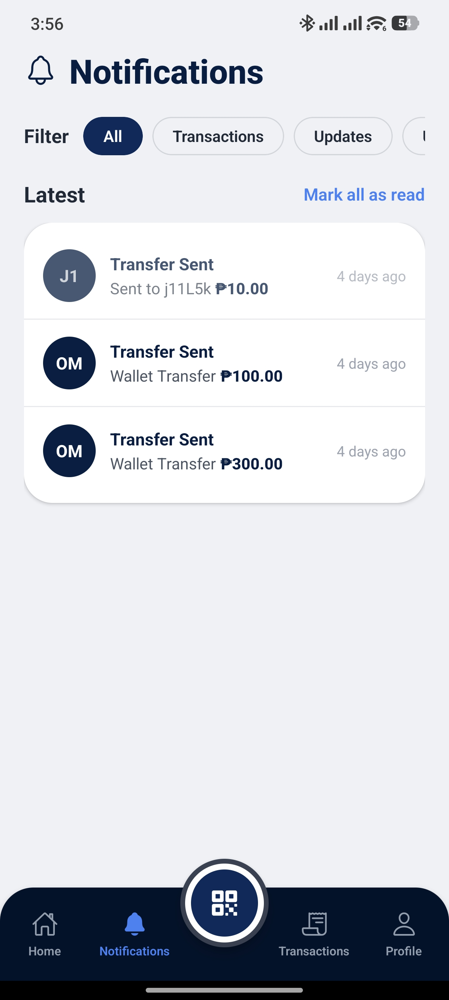<br /><sub>Notifications</sub></td>
<td align="center">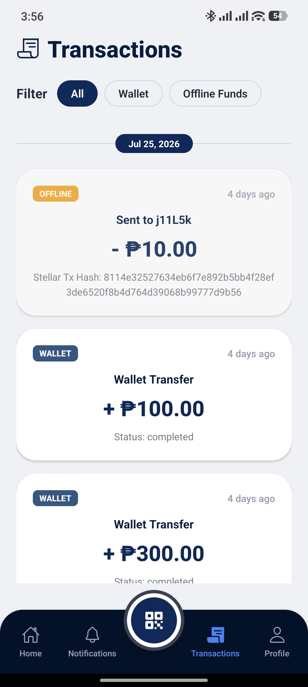<br /><sub>Transaction history</sub></td>
</tr>
<tr>
<td align="center">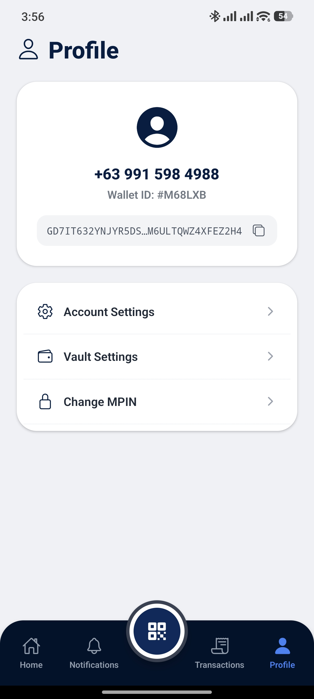<br /><sub>Profile</sub></td>
<td align="center">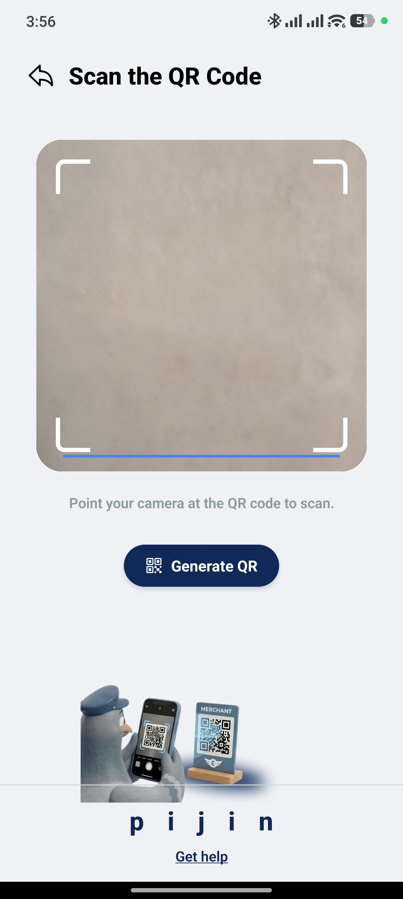<br /><sub>QR scanner</sub></td>
<td align="center"><br /><sub>Camera permission</sub></td>
<td align="center">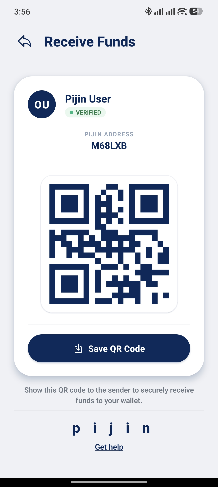<br /><sub>Receive money QR</sub></td>
</tr>
</table>

</details>

<details open>
<summary><strong>Offline payment flow</strong> (signed voucher → SMS or QR relay)</summary>

<br />

<table>
<tr>
<td align="center">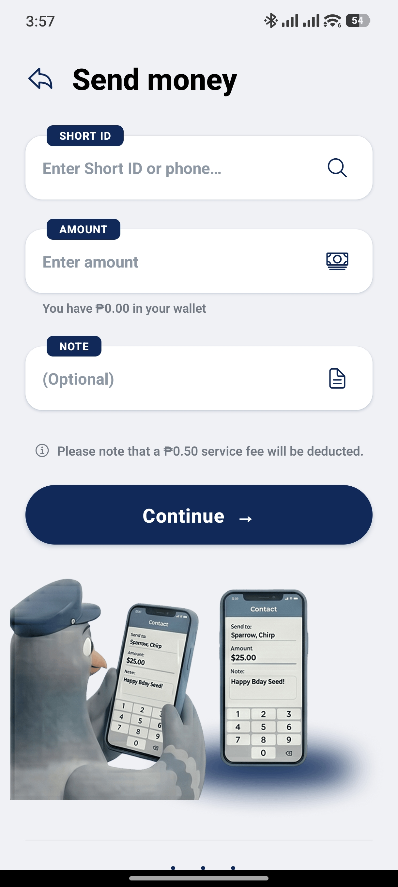<br /><sub>Send money</sub></td>
<td align="center">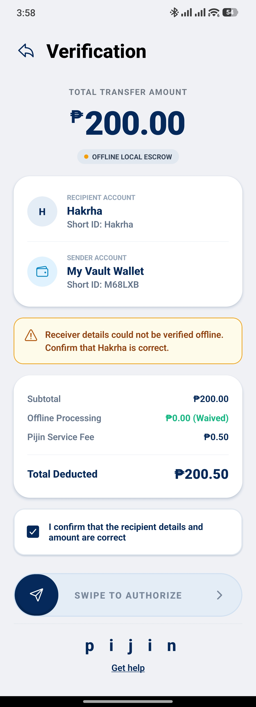<br /><sub>Review and authorize</sub></td>
<td align="center">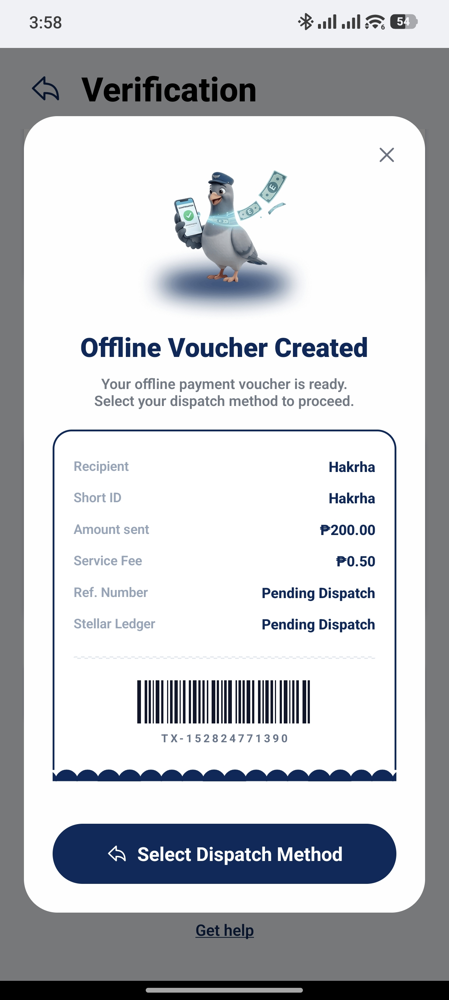<br /><sub>Offline voucher created</sub></td>
<td align="center">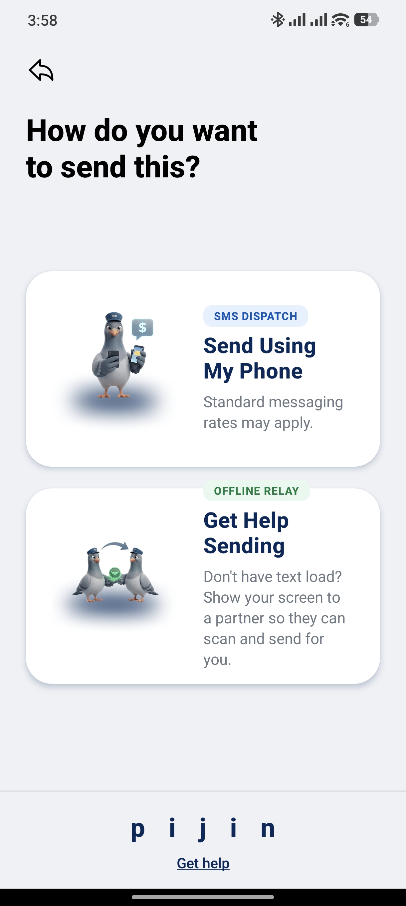<br /><sub>Select dispatch method</sub></td>
</tr>
<tr>
<td align="center">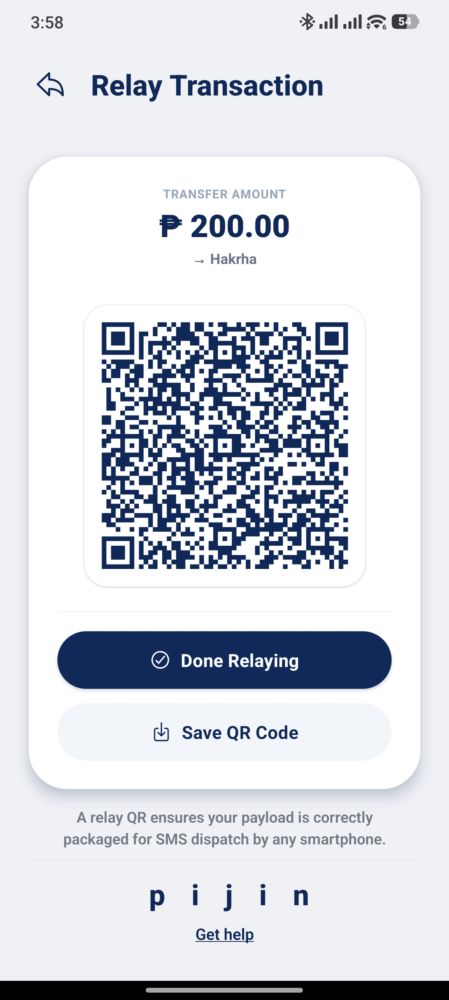<br /><sub>Relay transaction QR</sub></td>
<td></td>
<td></td>
<td></td>
</tr>
</table>

</details>

<details open>
<summary><strong>Wallet funding and balance movement</strong> (mobile)</summary>

<br />

<table>
<tr>
<td align="center"><br /><sub>Online wallet → offline funds</sub></td>
<td align="center">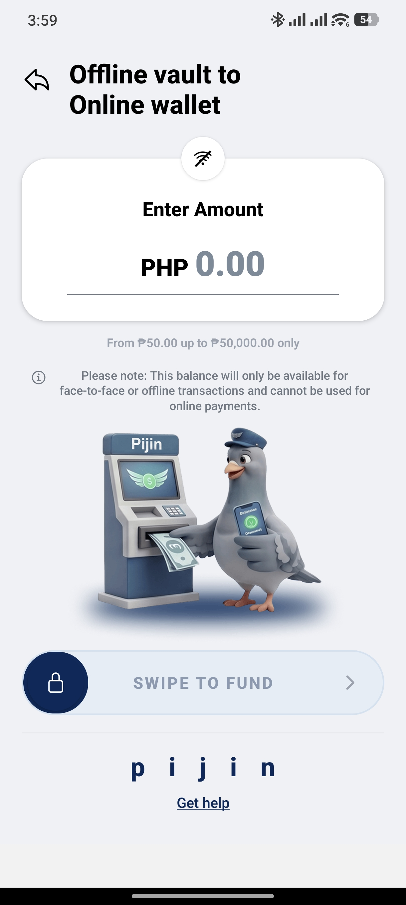<br /><sub>Offline vault → online wallet</sub></td>
<td align="center">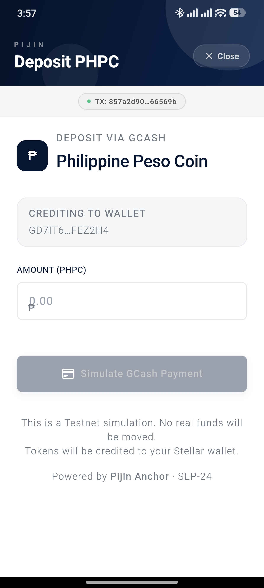<br /><sub>Deposit PHPC via GCash</sub></td>
<td align="center">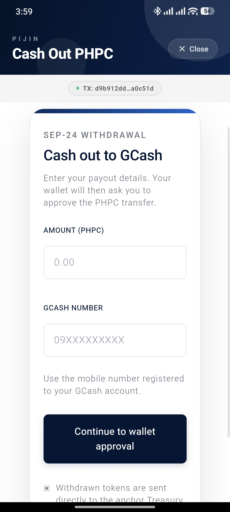<br /><sub>Cash out PHPC to GCash</sub></td>
</tr>
</table>

</details>

## 🌐 Deployment

### Stellar Testnet (development & preview builds)

| Component | Address |
|---|---|
| **Pijin Smart Contract** | [`CBYRV2FDGXHMKQILP3EWYI4ILKKQ2HW4NW4NJCFYQY6NEE7463ARLNUD`](https://stellar.expert/explorer/testnet/contract/CBYRV2FDGXHMKQILP3EWYI4ILKKQ2HW4NW4NJCFYQY6NEE7463ARLNUD) |
| **PHPC Token (Stellar Asset Contract)** | [`CADDQRI74FSCGNWMK4CLNDUSBDWJHMF2GHZQQVYQ4UIO7KZ7V6UK6C24`](https://stellar.expert/explorer/testnet/contract/CADDQRI74FSCGNWMK4CLNDUSBDWJHMF2GHZQQVYQ4UIO7KZ7V6UK6C24) |
| **PHPC Issuer** | [`GCBC6SUF536YKVWQVX3LXZIGXYHW6ZX3CKHGNNSOPVCDGPFWC73YMSWK`](https://stellar.expert/explorer/testnet/asset/PHPC-GCBC6SUF536YKVWQVX3LXZIGXYHW6ZX3CKHGNNSOPVCDGPFWC73YMSWK) |
| **Admin** | `GAZDBPU7QQWHOZ53MFQO5I2O6OSAQSEOE3OMXDZNBXJCRV2RPVTGDYKS` |
| **Treasury** | `GBV6SIDIZVHR22Y4KH4MTTYQOGSKNHZ27IWGSHVIHMK2HUUERVVMKFAM` |
| **Registrar** | `GAFVQPZFHN5GUCTXZQXC6RKI4U4R47VNANCDSZ7KES4KQ7MEWJKUZOKH` |
| **Gateway / Relayer** | `GDTDK62M4ZJU6QPCEFUSQWOPYED4I4GPHLB4ZZTMBZZL2AO2VK63VQUH` |
| **Token DB id** (`EXPO_PUBLIC_TOKEN_DB_ID`) | `1` |
| **Network passphrase** | `Test SDF Network ; September 2015` |

| Service | URL |
|---|---|
| Website, docs and API reference | [pijin.live](https://pijin.live) |
| Backend for the EAS `development` profile | `pijin-api.vercel.app` |
| Backend for the EAS `preview` profile | `preview-pijin.vercel.app` |

To deploy your own instance (contract, assets, SMS gateway, Vercel and EAS), follow the **[Setup & Integration Guide](https://pijin.live/docs#deploy)**.

- 📸 **Screenshot — Stellar Expert (Testnet)**


## 🎥 Demo


- 🔗 **Pijin Website:** [pijin.live](https://pijin.live)
- 🔗 **Pijin App Simulator:** [pijin.live/demo-split](https://pijin.live/demo-split) (desktop browser, real Testnet settlement)
- 📱 **Live Mobile App:** [APK Link](https://expo.dev/accounts/senec4/projects/pijin-app/builds/fa770cff-7d57-44f9-b94d-8a1e1c73e2aa)
- 📘 **Setup & Integration Guide:** [pijin.live/docs](https://pijin.live/docs)
- 📚 **API Reference:** [pijin.live/api-docs](https://pijin.live/api-docs)
- 🔗 **Treasury Portal:** [Pijin Treasury Portal](https://pijin-treasury-portal.vercel.app)
- 🔗 **𝕏 Account:** [Pijin X Account](https://x.com/supportpijin)
- 🎬 **Demo Video:** [Google Drive link](https://drive.google.com/drive/folders)

<div align="center">

## Build on Stellar Philippines Hackathon 2026 Champion  - Abot Pera

  
</div>

<div align="center">
  
## 👨‍💻 Team

</div>

<div align="center">
  
| Name | Role | GitHub |
|---|---|---|
|Mark Kengie Aldabon| Frontend Developer / DevOps | [@Mark](https://github.com/tambayNgOrtigasAvenue ) |
| Carl Arbolado | Backend Developer / Frontend Developer / Team Lead | [@Carl](https://github.com/Kaido147) |
| Erickson Guhilde | Frontend Developer / Backend Developer / Quality Assurance | [@Erickson](https://github.com/riXoon) |
| Cedric Paul Mendoza | System Architect / System Analyst | [@Cedric](https://github.com/daeroSys) |
| Janrell Quiaroro | Backend Developer / Quality Assurance / Web3 Architect | [@Janrell](https://github.com/0xreru) |
</div>

## 📜 License

Pijin is open source under the [MIT License](LICENSE) © 2026 The Pijin Team.

Contributions are welcome. See the [Contributing section of the guide](https://pijin.live/docs#contributing) to get started.
